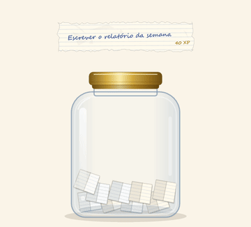
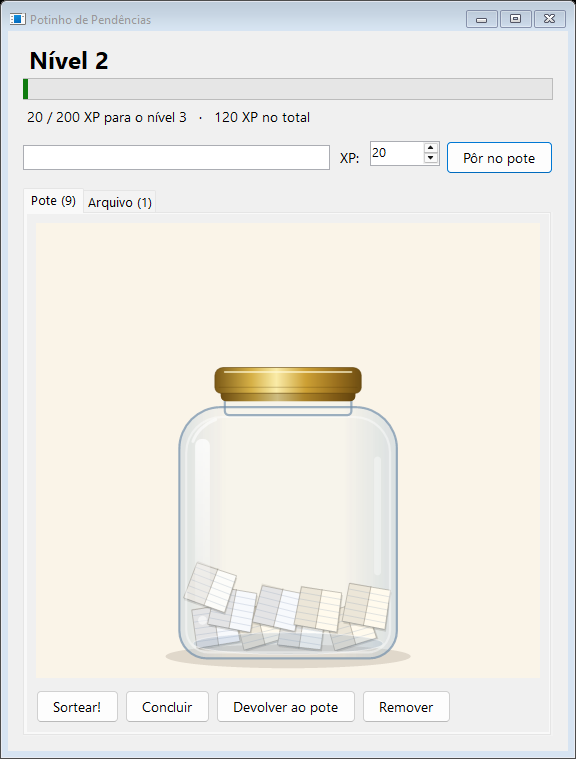

# Potinho de Pendências

Um pote de vidro para as suas tarefas. Você escreve a pendência num papelzinho, ele se dobra e cai no pote. Quando não souber por onde começar, sorteie: um papel sobe, se desdobra e diz o que fazer. Cada tarefa concluída rende XP e faz você subir de nível.

App de desktop para Windows (C# WinForms, .NET 10), todo desenhado à mão com GDI+.

| Pôr no pote | Sortear |
|:---:|:---:|
|  |  |



## O que ele faz

- **Pôr no pote:** escreva a pendência, escolha quanto XP ela vale e aperte Enter.
- **Sortear!:** a tampa abre e um papel aleatório sai do pote. Também dá para clicar num papelzinho específico.
- **Concluir:** a tarefa vai para a aba Arquivo, com a data, e o XP entra na sua conta.
- **Devolver ao pote:** o papel se dobra e volta para dentro.
- **Remover:** tira a tarefa do pote sem ganhar XP.
- **Níveis:** subir do nível N para o N+1 custa 100 × N XP.

Os dados ficam em `%APPDATA%\PotinhoDePendencias\dados.json`.

## Como usar

1. Instale o [.NET 10 Desktop Runtime](https://dotnet.microsoft.com/download/dotnet/10.0) (x64), se ainda não tiver.
2. Baixe o `PotinhoDePendencias.exe` na página de [Releases](../../releases) e abra.

## Compilar

```sh
dotnet publish -c Release -r win-x64 --self-contained false -p:PublishSingleFile=true -o publish
```

Testes da lógica: `PotinhoDePendencias.exe --teste` (sai com código 0 quando tudo passa). Os critérios de aceite estão em [docs/QUALIDADE.md](docs/QUALIDADE.md).
